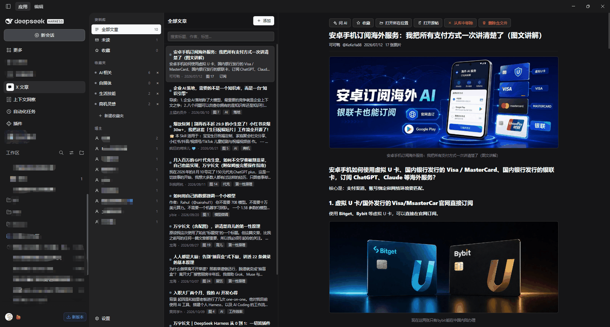
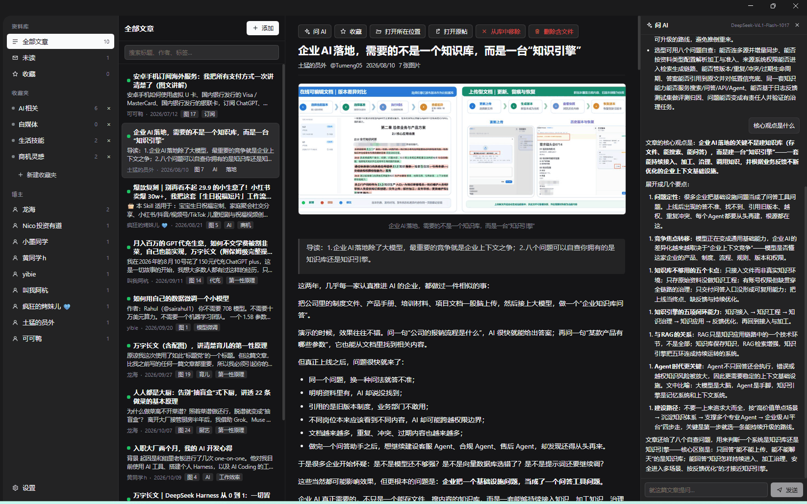

# X Article Library

[English](README_EN.md) · [简体中文](README.md)

A DSH desktop plugin that saves public X (Twitter) posts and long-form threads as offline-readable Markdown, organized by collections and authors and read in a three-pane reader.

**No X login, no reading your bookmarks, no X API.** It only handles public links you paste yourself.



Left: library navigation (All / Unread / Starred / Collections / Authors). Middle: article list. Right: Markdown reading pane. Collections and tags live only in the index—reorganizing never moves files on disk.

## Features

- **Paste to save**: paste multiple links at once; post IDs are detected and deduplicated. Plain numeric IDs also work.
- **Markdown on disk**: each article is a folder with its body, metadata and local images—readable without this plugin.
- **Three-pane reader**: left for navigation (All / Unread / Starred / Needs attention / Collections / Authors), middle for the article list (search, status, progress), right for Markdown reading.
- **Organize without moving files**: collections and tags are index-only; renaming or reclassifying never moves files on disk.
- **Local images**: images in the body are downloaded to `assets/` and rewritten to relative paths, so they work offline.
- **Configurable storage**: set any directory in settings ("Browse…" opens a native folder picker); "Open" reveals it in your file manager.
- **Reveal file**: "Open file location" in the reader selects that article's `article.md` in your file manager.
- **Context menus**: right-click an article to rename, change collections, star, reveal, remove or delete; right-click a collection to rename or delete it.
- **Ask AI**: click "Ask AI" in the reader toolbar to open an AI sidebar that automatically summarizes the whole article, then keeps answering follow-up questions. It uses DSH's currently selected model, so switching models just works.
- **Adjustable font size**: a slider in the toolbar resizes body text instantly (12–22px) and remembers your choice; headings scale along with the body.
- **Three reading states**: each list item carries an Unread / Reading / Read badge. Opening an article marks it Reading; it becomes Read once you scroll to the end. The Unread filter includes in-progress articles.
- **Focus mode**: click "Focus mode" to hide both sidebars and all toolbar actions, leaving only the text for immersive reading. Exit with the floating button or `Esc`.
- **Sticky toolbar**: the toolbar stays pinned to the top of the reading area while you scroll.
- **Highlights & comments**: select text in the body to reveal a small toolbar—highlight it or add a comment. Marks are written into `article.md` and shown as highlights with a hoverable comment bubble.
- **Bilingual UI**: switch the entire interface between Chinese and English in Settings; the choice is remembered.
- **AI tool**: registers an `x_article_library` tool so an agent can add links, list articles and read content in a conversation.

## Installation

Requires DSH desktop `0.2.2` or newer.

### From GitHub

```powershell
# Run on the machine with DSH. Replace <your DSH profile> with the real profile directory.
cd $env:DSH_PROFILE_DIR
pnpm add github:Menpengpeng/dsh-plugin-x-article-library
```

Then make sure `~/.dsh/profiles/desktop/package.json` contains `@menpengpeng/dsh-plugin-x-article-library` under `dsh.profile.bundles`. Restart DSH and an "X Articles" entry appears in the sidebar.

### From a local directory

```powershell
# In the repository root
cd $env:DSH_PROFILE_DIR
pnpm add file:<absolute path to this repository>
```

Then add the package name to `dsh.profile.bundles` in `package.json` and restart DSH.

## Usage

1. Click "X Articles" in the sidebar.
2. Click "+ Add" and paste public X links (e.g. `https://x.com/user/status/1234567890`); multiple links are fine.
3. Choose the content scope: **include the author's own thread** (full long-form post) or **single post only**.
4. Downloads run in the background; finished articles appear in the list automatically. Click one to read it on the right.

### Settings

- **Storage root**: defaults to `~/Documents/X Article Library`. "Browse…" opens a **native folder picker** (provided by the host's `ctx.directoryPicker` backend in DSH desktop); on headless setups it falls back to an in-app directory browser. The "Open" button beside the field reveals the directory in your file manager. Changing it **only affects future downloads**—existing files do not move, because each article remembers the root it was downloaded under, so old articles remain readable, deletable and locatable.
- **Concurrent downloads**: 1–4, default 2.
- **Images**: download locally or keep remote links.
- **Scan storage**: re-index folders you placed manually under `articles/`.

### Context menus

**Right-click an article card**:

| Menu item | Meaning |
| --- | --- |
| Rename title… | Changes only the title; body and file location stay put |
| Add to / Remove from favorites | Toggles the star |
| Change collections… | A checkbox dialog; change several collections at once |
| Open file location | Selects `article.md` in your file manager (downloaded only) |
| Remove from library | Deletes the index entry only; keeps the file on disk |
| Delete with file | Deletes both the index entry and the file on disk |

**Right-click a collection** in the left pane: rename or delete it.

Renaming a title, changing tags or collections **rewrites the `article.md` Front Matter** so what's in the file matches the library. The body is left untouched and nothing is re-downloaded.

### Revealing files

"Open file location" in the toolbar **selects** that article's `article.md` in your system file manager:

- Windows: `explorer.exe /select,` (Explorer exits with code 1 on a successful handoff, which the plugin treats as success)
- macOS: `open -R`
- Linux: opens the parent directory (file managers have no unified "select file" protocol)

The "Open" button beside the storage field opens the currently entered directory; when the list is empty, the home screen also offers "Open storage folder".

### Font size

The slider in the reader toolbar resizes body text:

- Range 12–22px, default 14px. Changes are instant—no confirmation or reload.
- Releasing the slider saves the value (stored as `readerFontScale`), so it persists across restarts.
- Headings, subheadings and table text scale proportionally, so nothing looks out of sync.

### Reading states

Each article title has one of three badges on its right:

| Badge | Meaning | When it appears |
| --- | --- | --- |
| Unread (brand color) | Never opened | Newly imported articles |
| Reading (orange) | Opened but not finished | After opening, until you reach 95% |
| Read (gray) | Finished | Marked automatically at the end; short articles count as read on open |

Reading progress is remembered, and a red line in the body marks "you were here last time". The sidebar's Unread count and filter both include in-progress articles, so something you opened but didn't finish stays on your to-read list.

### Focus mode

Click "Focus mode" in the toolbar for immersive reading:

- Hides the left navigation, article list and every toolbar action, leaving only centered body text on a wider column.
- Automatically closes the "Ask AI" sidebar on entry so it can't crowd the text.
- A floating "Exit focus" button sits in the top-right, or press `Esc`; switching articles exits automatically.

### Highlights & comments

Select a passage in the body and a small toolbar appears:

- **Highlight**: mark the text with a yellow highlight and underline.
- **Comment**: type a note; the highlight gains an orange circular badge, and hovering opens a card showing the full comment at a readable font size with wrapping.

Marks are written directly into that article's `article.md` (`==highlight==` syntax, with comments stored as base64 in an adjacent HTML comment)—no separate file and no dependency on the plugin's index. Copy the Markdown elsewhere and your highlights and comments go with it. When the same text appears multiple times, an occurrence index locates the exact one.

### Interface language

The **Language** option in Settings switches between **Chinese / English**. The whole interface updates immediately and your choice is remembered.

## Ask AI

"Ask AI" sits at the right of the reader toolbar. Clicking it opens an AI sidebar:

1. It **reads the whole article and gives a structured summary automatically**—no extra click.
2. You can then ask follow-ups about that article; questions are sent together with the original text.
3. The model name is shown at the top.

It uses **the model currently selected in DSH** (read from the host's `agentDefaultModel`); there is no separate model config—change models in DSH and Ask AI follows immediately.



The screenshot shows the real result: the sidebar first summarizes the article, then a question "What's the core argument?" is answered from the same text.

Edge cases:

- Body text over 24,000 characters is truncated, with an explicit note to the model that the rest was omitted, so it never pretends to have read everything.
- Multi-turn history keeps only the last 8 turns and always starts with a `user` message (some providers reject histories starting with `assistant`).
- With no model available, you get a clear message (HTTP 501 plus readable text) instead of a guessed default.
- Switching articles closes the sidebar automatically so you never see the previous article's summary.

## Storage layout

```
<storage root>/
  articles/
    <postId>/
      article.md        # body with YAML Front Matter (UTF-8 BOM)
      metadata.json     # metadata and failed-image records
      assets/
        001.jpg         # localized image
```

The index itself lives at `~/.dsh/storages/x-article-library/index.json` and holds article metadata, collections, settings and job records. Deleting it does not affect Markdown on disk; "Scan storage" rebuilds it.

### Front Matter fields

`x_post_id`, `source_url`, `title`, `author_name`, `author_username`, `published_at`, `downloaded_at`, `thread_mode`, `tags`, `collections`, `image_count`.

## Content source

Body text comes from [Xtracticle](https://xtracticle.com)'s Markdown endpoint:

```
https://xtracticle.com/api/markdown/{post_id}?thread=1&front_matter=1
```

`thread=1` fetches the author's own thread; `thread=0` returns a single post. Therefore:

- **Only public content is readable**. Private, protected, deleted or age-restricted posts return "not accessible"—check on X that the post is public.
- Downloads depend on a third-party service; rate limits produce a "try again later" message.

### Proxy

X and its image host (`pbs.twimg.com`) usually need a proxy on some machines. The plugin includes a zero-dependency CONNECT tunnel client: it reads `HTTPS_PROXY` / `HTTP_PROXY` first, then the Windows registry `ProxyServer`, and otherwise connects directly. Enabling your system proxy is enough—no extra config.

## AI tool

Tool name `x_article_library`, parameter `action`:

| action | Purpose |
| --- | --- |
| `add` | Import links from `links`; optional `collection`, `threadMode` |
| `list` | List articles (up to 50) and collections |
| `read` | Read a body by `postId` (truncated to 20,000 characters) |
| `retry` | Re-queue all unfinished downloads |
| `settings` | Return the storage root, image cache and concurrency settings |

## HTTP endpoints

- `GET /api/x-article-library` — full current state snapshot.
- `POST /api/x-article-library` — body `{ "type": "...", ... }`; `type` is one of `parse` / `import` / `download` / `read` / `annotate` (write a highlight/comment back into the body) / `update` / `remove` / `createCollection` / `updateCollection` / `deleteCollection` / `settings` / `scan` / `browse` / `reveal` / `openFolder`.
- `GET /api/x-article-library/asset?postId=&name=` — read a local image.

All endpoints go through Harness Host/Origin authentication and return `Cache-Control: no-store`; POST must be `application/json` with a body up to 64 KiB.

## Security boundaries

- External content is always treated as untrusted: the Markdown renderer disables raw HTML, `<script>`, `<iframe>` and `javascript:` / `data:` protocols, and escapes all attribute values.
- Images accept only `jpeg/png/webp/gif/avif`; SVG is rejected because it can carry scripts.
- Every file path is checked with `isInside` and must stay under the storage root; asset reads accept only simple file names under `assets/`.

## Known limitations

- At most 30 images and 10 MiB per image per article.
- At most 100 links per import.
- Embedded X videos are not downloaded; the original link is kept.
- Content from platforms other than X long-form posts is not supported.

## File structure

```
x-article-library/
  package.json          # bundle metadata and dsh.bundle / dsh.client declarations
  cordis.patch.yml      # inserts the plugin entry
  index.js              # Host: HTTP routes, AI tool, service lifecycle
  client.js             # Client: three-pane UI + restricted Markdown renderer
  lib/http.js           # zero-dependency HTTP client (CONNECT proxy, decompression, redirects)
  lib/core.js           # link parsing, fetching, Front Matter, images and file writes
  lib/library.js        # index storage, download queue, article and collection services
  lib/reveal.js         # reveal files in file managers / open directories (cross-platform)
  tests/                # dependency-free self-test scripts
  locale/zh.json        # Chinese strings
  locale/en.json        # English strings
  icon.svg              # sidebar icon
```

## Development

There is no build step—the source is the artifact. After changes:

```powershell
node --check index.js
node --check client.js
node --check lib/http.js
node --check lib/core.js
node --check lib/library.js
node --check lib/reveal.js
node --check lib/assistant.js

# Run tests (no dependencies needed)
npm test
```

The debug endpoint requires a DSH session credential and rejects unauthenticated requests. To see logs, watch the terminal where DSH was started.

## Disclaimer

This plugin is only for saving **public content you already have the right to access**, for offline reading and search. Please follow X's terms of service and the laws of your region; do not use it for bulk scraping or redistribution of others' work. Content copyright remains with its original authors.

## Contributing

Issues and pull requests are welcome. Before submitting, please make sure:

- No new runtime dependencies are introduced (the HTTP client is deliberately dependency-free).
- External content is still treated as untrusted—do not add paths that bypass the protocol allowlist.
- Source files stay UTF-8 with BOM (`package.json` and `locale/*.json` excepted, since JSON with a BOM fails to parse).

## License

[MIT](LICENSE) © 2026 menpengpeng
